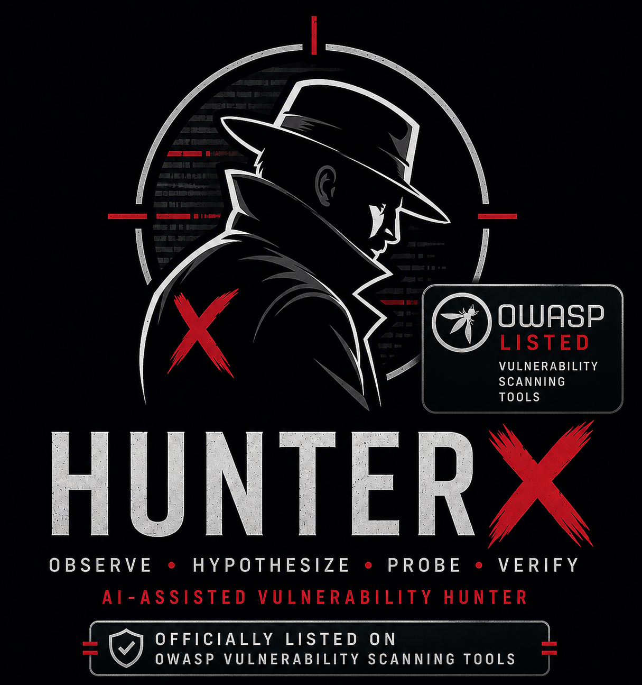

<div align="center">



# HunterX

**An AI-directed security assessment engine for authorized engagements.**

[Website](https://nullc0d30.github.io/HunterX/) · [Repository](https://github.com/nullc0d30/HunterX) · [PyPI](https://pypi.org/project/hunterxsec/) · [Docker](https://hub.docker.com/r/nullc0d30/hunterx)

[](https://github.com/nullc0d30/HunterX/releases)
[](https://www.python.org/)
[](LICENSE)
[](https://owasp.org/)
[](https://github.com/sindresorhus/awesome)
[](https://github.com/yeyintminthuhtut/Awesome-Red-Teaming)
[](https://github.com/avery-ai/awesome-ai-cybersecurity)

</div>

HunterX plans and runs security assessments against targets you are authorized to test. It
reconnoitres the target, picks the next test to run, executes the matching tool, reads the
result, and keeps going until the assessment is genuinely finished.

The strategic decisions come from an LLM (the *Hunt Director*). Everything else is
deterministic: HunterX enforces scope, authorization, budgets and tool contracts, and it
will not treat a raw tool output as a finding. A result has to survive validation, proof
and replay before it reaches a report.

## Installation

```bash
pip install hunterxsec
```

Or use the install script:

```bash
curl -sSL https://raw.githubusercontent.com/nullc0d30/HunterX/main/install.sh | sudo bash
```

Docker images are published to `nullc0d30/hunterx`. See
[docs/installation/index.md](docs/installation/index.md) for the full walkthrough.

Check the environment and the external tools HunterX drives:

```bash
hunterx install
hunterx tools check
```

## Usage

```bash
# Optional: configure an AI provider interactively
hunterx ai configure
hunterx ai check

# Start an assessment
hunterx hunt full_security_assessment https://example.com

# Follow progress
hunterx hunt status <mission_id>
hunterx hunt surface <mission_id>

# Inspect findings
hunterx finding list <mission_id>
hunterx finding poc <finding_id>
hunterx finding proof <finding_id>
hunterx finding replay <finding_id>

# Produce a report
hunterx report generate <finding_id>
hunterx report export <report_id> markdown
```

`hunterx hunt --deterministic` runs the same mission without an LLM. It is a separate
mode, not a fallback: tool selection is rule-based, and the mission stops where the rules
stop.

The CLI reference lives in [docs/cli/index.md](docs/cli/index.md).

## What a mission does

A normal run covers these stages:

1. **Discover** assets, services, technologies, endpoints, parameters, API schemas,
   JavaScript and authentication mechanisms.
2. **Test** the attack surface actively (injection, SSRF, IDOR/BOLA, XSS, traversal,
   command injection, SSTI, XXE, authn/authz, session handling, API/GraphQL, business
   logic, JWT, cloud misconfiguration and the rest of the built-in domain list).
3. **Validate** each candidate with differential probes and negative evidence.
4. **Prove** the finding against a proof contract with a minimal, safe PoC.
5. **Replay** it deterministically and record a verdict (`SUCCESS`, `FAILED`,
   `INCONCLUSIVE` or `BLOCKED`).
6. **Correlate** evidence across tools, build attack paths and score impact.
7. **Report** in Markdown, HTML, JSON, SARIF 2.1, PDF or an evidence bundle.

The Security Test Matrix tracks every applicable domain from `NOT_ASSESSED` through
`TESTED_POSITIVE_VALIDATED` / `TESTED_NEGATIVE` / `NOT_APPLICABLE_WITH_EVIDENCE` /
`BLOCKED_WITH_REASON`. A mission is complete only when all applicable domains are
terminal.

## AI providers

Provider and model are chosen independently. Cloud providers: OpenRouter, OpenAI,
Anthropic, DeepSeek, Google Gemini, xAI and any OpenAI-compatible endpoint (Requesty).
Local: Ollama, LM Studio and other OpenAI-compatible servers.

```env
HUNTERX_AI_PROVIDER=openrouter
HUNTERX_AI_MODEL=deepseek/deepseek-chat
HUNTERX_AI_OPENROUTER_KEY=sk-or-...
```

For a local model:

```env
HUNTERX_AI_PROVIDER=ollama
HUNTERX_AI_MODEL=qwen2.5:3b-instruct
HUNTERX_AI_BASE_URL=http://127.0.0.1:11434/v1
```

Details: [docs/configuration/ai.md](docs/configuration/ai.md).

## Safety and scope

- Every target is checked against the authorized scope before a tool runs.
- Authorization is explicit. Scope never grows on its own because a tool found something.
- Each AI decision passes a policy gate: scope, authorization, budget, tool availability
  and safety are all checked before execution.
- Proofs are minimal and bounded; secrets are redacted and destructive payloads are
  refused.
- Findings always link back to the observation, evidence, validation, proof or tool result
  that produced them.

HunterX is for authorized testing only. Read [docs/responsible-use.md](docs/responsible-use.md)
before pointing it at anything.

## Tools

HunterX drives 90+ external tools through capability contracts, including nmap,
subfinder, nuclei, ffuf, sqlmap, dalfox, katana, httpx, dnsx, naabu, masscan, trivy,
prowler and scoutsuite. Tools are detected and verified before a mission starts; run
`hunterx tools check` to see per-tool status and capability coverage.

Reference: [docs/tool-ecosystem.md](docs/tool-ecosystem.md) and
[docs/tool-readiness.md](docs/tool-readiness.md).

## Documentation

| Topic | Link |
| --- | --- |
| Installation | [docs/installation/index.md](docs/installation/index.md) |
| AI configuration | [docs/configuration/ai.md](docs/configuration/ai.md) |
| CLI reference | [docs/cli/index.md](docs/cli/index.md) |
| Tool ecosystem | [docs/tool-ecosystem.md](docs/tool-ecosystem.md) |
| Validation and PoC | [docs/poc-validation.md](docs/poc-validation.md) |
| Responsible use | [docs/responsible-use.md](docs/responsible-use.md) |
| Release notes | [CHANGELOG.md](CHANGELOG.md) |

The documentation site is built from `docs/` and published at
https://nullc0d30.github.io/HunterX/.

## Contributing

Bug reports and pull requests are welcome. See [CONTRIBUTING.md](CONTRIBUTING.md).
Pull requests must pass the test suite and the linters.

## License

Apache License 2.0. See [LICENSE](LICENSE).

## Responsible use

HunterX is a testing platform for authorized security work. You are responsible for
getting permission before you test any system. The author is not liable for misuse,
unauthorized access or damage caused by this software.

---

Copyright © 2026 Ahmed Awad (NullC0d3).
